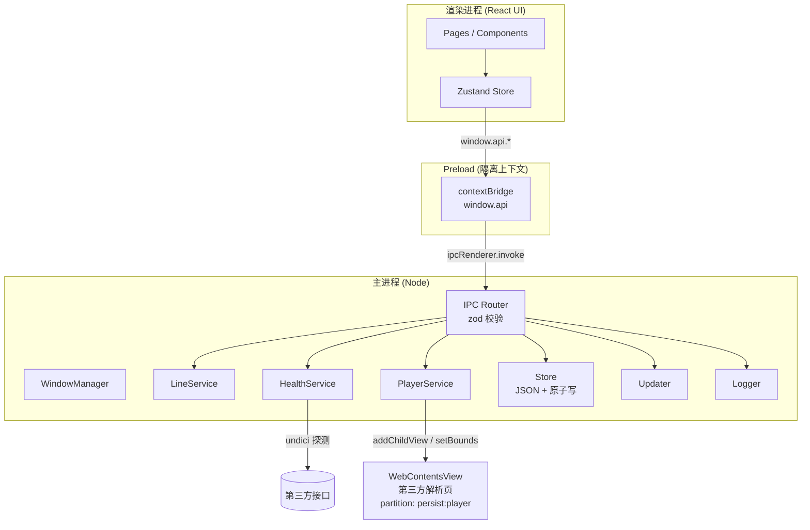

# Free Video · 技术架构文档

| 项目 | 内容 |
| --- | --- |
| 文档版本 | v1.0 |
| 编写日期 | 2026-10-29 |
| 关联文档 | [需求文档 PRD](./Prd.md) |
| 技术栈 | Electron 44 · TypeScript 5.9 · React 19 · Vite 8(electron-vite 6) · Tailwind CSS 4 · shadcn/ui |
| 构建分发 | electron-builder 26 + GitHub Actions（三平台矩阵） |

---

## 1. 架构目标

本文档回答"怎么实现 PRD 里的功能"，约束如下：

1. **安全默认**：渲染进程不可碰 Node，所有系统能力经 preload 白名单暴露；
2. **单一真相源**：业务状态只在主进程持久化，渲染进程是"视图 + 缓存"；
3. **可替换**：线路（解析接口）是数据不是代码，失效时改 JSON 不改程序；
4. **跨平台一致**：UI 只依赖 Chromium，系统差异收敛在主进程的少量适配函数里；
5. **可持续构建**：`pnpm dev` 一条命令起开发环境，`git tag` 一条命令出三平台安装包。

---

## 2. 技术选型

| 层 | 选型 | 理由 | 备选与放弃原因 |
| --- | --- | --- | --- |
| 容器 | **Electron 44** | 需要内嵌任意第三方 Web 页面并能控制会话/权限；Electron 的 `WebContentsView` 与 `session` 控制粒度最细 | Tauri：系统 WebView 版本碎片化，且难以对第三方页面做会话隔离 |
| 构建 | **electron-vite 6** | 一份配置同时产出 main / preload / renderer，HMR 覆盖三个进程 | 手写 Rollup/Vite 配置成本高 |
| 语言 | **TypeScript 5.9**（strict） | IPC 契约、线路模型需要编译期约束 | — |
| 持久化 | **electron-store 12** | Electron 生态事实标准；原子写、读取缓存、文件监听、损坏文件处理开箱即用；v12 要求 Electron ≥ 35（本项目 44） | 自研 JSON 存储：重复造轮子且要自己处理崩溃写坏；`conf` 直接用：缺少面向 Electron 的 `userData`/`name` 约定 |
| UI 框架 | **React 19** | 生态最全，shadcn/ui 一等公民 | Vue：与 shadcn 生态不匹配 |
| 样式 | **Tailwind CSS 4** | 原子类 + CSS 变量主题，配 shadcn/ui 无需额外设计系统 | 手写 CSS Modules：主题切换与暗色成本高 |
| 组件 | **shadcn/ui**（源码内置） | 组件以源码形式落在仓库里，可改可审，无运行时依赖包袱；基于 Radix 保证可访问性 | Ant Design：样式体系与 Tailwind 冲突、定制成本高 |
| 图标 | **lucide-react** | shadcn 默认图标集 | — |
| 状态 | **Zustand 5** | 客户端状态轻量、无 Provider 嵌套；跨窗口场景足够 | Redux Toolkit：模板代码过重 |
| 路由 | **React Router 7（Hash 模式）** | 打包后页面走 `file://`，Hash 路由无需主进程协议适配 | 自研视图切换：深链接与返回栈要自己实现 |
| 校验 | **Zod 4** | IPC 入参、存储文件、导入 JSON 三处共用一套 schema | 手写校验易漏 |
| 日志 | **electron-log 5** | 主/渲染进程统一落盘，支持按大小轮转 | console 在打包后不可见 |
| 更新 | **electron-updater 6** | 与 electron-builder 天然配套，GitHub Releases 直连 | 自研更新器工作量大且平台差异多 |
| 测试 | **Vitest**（node + jsdom 双环境） | 与 Vite 共用配置，启动快 | Jest：ESM 与 Vite 生态适配差 |

> 版本以 `package.json` 为准，本表只表达选型意图。

---

## 3. 整体架构

### 3.1 进程模型



### 3.2 职责边界

| 进程 | 负责 | 明确不负责 |
| --- | --- | --- |
| Main | 窗口生命周期、播放容器、网络探测、持久化、更新、外链、权限拦截 | 任何 UI 渲染 |
| Preload | 把主进程能力收窄成 5 个命名空间的方法，零业务逻辑 | 状态持有、网络请求 |
| Renderer | 页面渲染、交互状态、表单校验提示 | 直接发网络请求、读写文件 |

**关键原则**：渲染进程不直接请求第三方接口。线路探测、解析页加载都在主进程完成，天然规避 CORS，也让第三方页面运行在独立 `partition` 中，不污染主 UI。

### 3.3 模块格式（ESM / CJS）

Electron 与 electron-vite 均支持 ESM，但有一条不可绕过的硬约束：**sandboxed preload 必须是 CJS**（Electron 的 ESM preload 要求 `sandbox: false`）。本项目坚持 `sandbox: true`，因此采用"主进程 ESM + preload CJS"的混合产物，而不是给 `package.json` 加 `"type": "module"`（那会把 preload 也切成 `.mjs`，进而被迫关闭沙箱）。

| 目标 | 格式 | 产物 | 原因 |
| --- | --- | --- | --- |
| main | ESM | `out/main/index.mjs` | 使用纯 ESM 依赖（electron-store 12） |
| preload | CJS | `out/preload/index.js` | sandbox 限制 |
| renderer | ESM | Vite 产物 | 天然 ESM |

```ts
// electron.vite.config.ts —— 只改 main，preload 保持默认 CJS
export default defineConfig({
  main: { build: { rollupOptions: { output: { format: 'es' } } } },
  preload: {},
  renderer: { /* ... */ }
})
```

同时把 `package.json` 的 `main` 改为 `./out/main/index.mjs`。

ESM 主进程的两个常见坑：

- `__dirname` / `__filename` 不存在 → 用 `import.meta.dirname`（Node 22+，Electron 44 已内置）；
- CJS 包不能用具名导入 → `import updater from 'electron-updater'`，写成 `import { autoUpdater }` 会抛 `SyntaxError`。

---

## 4. 目录结构

```
free-video/
├─ src/
│  ├─ main/                      # 主进程
│  │  ├─ index.ts                # 入口：app 生命周期编排
│  │  ├─ window.ts               # 主窗口创建、状态记忆
│  │  ├─ ipc/
│  │  │  ├─ index.ts             # 注册所有 handler
│  │  │  ├─ register.ts          # 类型安全的 handle() 包装（先 removeHandler 再 handle）
│  │  │  ├─ broadcast.ts         # 主 → 所有窗口的事件广播
│  │  │  └─ handlers/            # app / settings / lines / player / history / favorites / updater
│  │  ├─ services/
│  │  │  ├─ store.ts             # electron-store 封装：read/write + zod + 损坏备份
│  │  │  ├─ migrations/          # 各域数据版本迁移（纯函数，逐步可测）
│  │  │  ├─ line-service.ts      # 线路 CRUD、内置/用户合并、导入导出
│  │  │  ├─ health-service.ts    # 并发探测与状态回写
│  │  │  ├─ player-service.ts    # WebContentsView 生命周期与 bounds
│  │  │  ├─ history-service.ts   # 播放历史（去重 + 上限 100）
│  │  │  ├─ favorites-service.ts # 收藏
│  │  │  ├─ window-state.ts      # 窗口位置/尺寸记忆
│  │  │  ├─ updater.ts           # electron-updater 封装
│  │  │  └─ logger.ts
│  │  └─ lib/
│  │     └─ concurrency.ts       # 并发限流（worker pool）
│  ├─ preload/
│  │  ├─ index.ts                # contextBridge.exposeInMainWorld('api', api)
│  │  └─ index.d.ts              # window.api 类型声明
│  ├─ shared/                    # 三端共享：只放类型/纯函数/常量，禁止 import node 模块
│  │  ├─ types.ts                # ParseLine / Settings / HistoryItem ...
│  │  ├─ api.ts                  # window.api 的接口定义（preload 与渲染层共用）
│  │  ├─ ipc.ts                  # IpcContract 契约表 + NOTIFY 通道名
│  │  ├─ schemas.ts              # zod schema（唯一校验来源）
│  │  ├─ join-url.ts             # 线路拼接（prefix / template）
│  │  ├─ platform.ts             # 平台域名识别
│  │  └─ constants.ts            # 默认设置、上限、免责声明文本
│  └─ renderer/
│     ├─ index.html
│     └─ src/
│        ├─ main.tsx
│        ├─ App.tsx              # HashRouter + 免责声明门禁 + 主题应用
│        ├─ components/
│        │  ├─ ui/               # shadcn 生成物（button/input/dialog/select/switch...）
│        │  ├─ Layout.tsx        # 侧边导航骨架
│        │  └─ PlayerSurface.tsx # 播放容器占位层（负责 bounds 同步）
│        ├─ pages/               # Home / Lines / History / Favorites / Settings
│        ├─ store/               # Zustand slices（settings / lines / player）
│        ├─ lib/                 # cn()、api 门面、格式化工具
│        └─ assets/main.css      # Tailwind 入口 + 主题变量
├─ resources/
│  └─ lines.default.json         # 内置线路库（构建期静态 import 进主进程包）
├─ build/                        # 图标、entitlements、签名资源
├─ docs/                         # Prd.md / Arch.md
├─ electron.vite.config.ts
├─ electron-builder.yml
└─ components.json               # shadcn 配置
```

**分层规则**

- `features/*` 之间不互相 import，共享部分下沉到 `components/` 或 `lib/`；
- `shared/` 只能是纯 TypeScript（无 `node:`、无 `electron`），否则 preload/renderer 打包会炸；
- 主进程服务之间不直接互调，通过 `index.ts` 编排依赖。

---

## 5. 主进程设计

### 5.1 启动时序

```
app.whenReady()
 ├─ initLogger()                // 先起日志，后续所有异常可落盘
 ├─ registerIpcHandlers()       // 幂等注册，避免 dev 热重载重复注册
 ├─ createMainWindow()
 ├─ initServices()              // Store 加载 → LineService 合并内置线路
 └─ scheduleStartupHealthCheck()// 延迟 3s 后台探测，不阻塞首屏
```

单实例锁 `app.requestSingleInstanceLock()`；第二次启动时聚焦已有窗口。

### 5.2 窗口管理

- 默认 `1440×900`，最小 `1024×680`，位置与尺寸记忆到 storage；
- 骨架阶段使用系统原生标题栏（`titleBarStyle` 保持默认）：跨平台行为一致、无需处理拖拽区吞事件；
  后续若引入自绘标题栏，再切换为 `hiddenInset`（mac）+ 自绘（win/linux），并由 `components/layout/TitleBar.tsx` 统一承载；
- 标题栏拖拽区用 CSS `-webkit-app-region: drag`，**所有可交互元素必须显式 `no-drag`**（见 §11 已知问题）；
- 窗口 `resize` / `maximize` / `enter-full-screen` 事件统一转发给 `PlayerService` 重新计算播放容器 bounds。

### 5.3 服务说明

| 服务 | 关键实现 |
| --- | --- |
| `store.ts` | 每域一个 `electron-store` 实例（原子写、缓存由库负责）；读出后统一过 zod，失败则把原文件备份为 `<name>.corrupt-<ts>.json` 并以默认值重建；对外只暴露 `read()` / `write()` |
| `line-service.ts` | 内置线路（只读模板）+ 用户覆盖层（enabled/order/name）+ 自定义线路合并；`builtin` 项不允许删除 |
| `health-service.ts` | Node 内置 `fetch`（undici）发 `GET`，`AbortSignal.timeout(8s)`，并发 6；结果写回 store 并广播 `lines:health-changed` 事件 |
| `player-service.ts` | 唯一持有 `WebContentsView`；状态机 `idle → loading → playing → failed`；负责超时计时、`did-fail-load`、自动切线路 |
| `updater.ts` | 仅打包环境启用；dev 下直接返回"开发模式不支持更新" |

---

## 6. IPC 契约

### 6.1 契约表

`src/shared/ipc.ts` 是唯一真相源，主进程注册与 preload 暴露都由它推导出类型：

```ts
export interface IpcContract {
  // 线路
  'lines:list': () => ParseLine[]
  'lines:upsert': (line: ParseLineInput) => ParseLine
  'lines:remove': (id: string) => void
  'lines:reorder': (ids: string[]) => void
  'lines:check': (ids?: string[]) => Record<string, LineHealth>
  'lines:import': (json: string) => ImportResult
  'lines:export': () => string
  // 播放
  'player:open': (input: { lineId: string; videoUrl: string }) => PlayResult
  'player:close': () => void
  'player:set-bounds': (rect: Rect) => void
  'player:set-visible': (visible: boolean) => void
  'player:reload': () => void
  'player:toggle-fullscreen': () => void
  // 设置 / 历史 / 更新
  'settings:get': () => Settings
  'settings:patch': (patch: Partial<Settings>) => Settings
  'history:list': () => HistoryItem[]
  'history:add': (item: HistoryItemInput) => void
  'history:clear': () => void
  'updater:check': () => UpdateStatus
}
```

主进程侧封装：

```ts
export function handle<K extends keyof IpcContract>(
  channel: K,
  fn: (...args: Parameters<IpcContract[K]>) => ReturnType<IpcContract[K]>
): void {
  ipcMain.handle(channel, async (_e, ...args) => fn(...(args as Parameters<IpcContract[K]>)))
}
```

### 6.2 约定

- **只用 `invoke/handle`**，不用 `send/on` 传业务数据；主进程 → 渲染进程的唯一推送是若干通知频道（`player:state`、`lines:health-changed`、`updater:status`），在 preload 里包成 `onXxx(cb) → unsubscribe`；
- **入参必校验**：每个 handler 开头 `schema.parse(args)`，解析失败抛 `IpcError('E_INVALID_INPUT')`；
- **错误规整**：主进程不把原始异常抛给渲染层，统一 `{ code, message }` 结构，渲染层按 code 映射文案；
- **不传大对象**：历史列表分页（默认 100 条上限）由主进程截断。

---

## 7. 渲染进程设计

### 7.1 组件分层

```
Pages (features/*)
  └─ 组合层 components/{layout,player}
       └─ 基础层 components/ui (shadcn)
            └─ Radix 原语 + Tailwind 类
```

- `components/ui/*` 由 shadcn CLI 生成，**视为项目源码**：可以改样式，但不要在此层写业务逻辑；
- 业务状态全部走 `stores/`，组件不直接调用 `window.api`（统一在 store action 或 feature hook 中调用），便于测试与 mock；
- 表单用 `react-hook-form + @hookform/resolvers + zod`，与 shared 的 schema 复用。

### 7.2 状态划分

| Store | 内容 | 持久化 |
| --- | --- | --- |
| `useSettingsStore` | 主题、超时、自动切换、代理、UA | 主进程（`settings:patch` 后回填） |
| `useLinesStore` | 线路列表、当前选中线路、探测中状态 | 主进程为真相源，本地仅缓存 |
| `usePlayerStore` | 播放状态机、当前 url、是否全屏、错误信息 | 不持久化 |
| `useHistoryStore` | 历史、收藏 | 主进程 |

渲染进程启动时执行一次 `hydrate()`：并发拉取 settings / lines / history，失败时展示"加载失败，重试"空态而非白屏。

### 7.3 路由

```
#/                 首页（地址输入 + 线路快选 + 最近播放）
#/play             播放页（占位层 + 控制条，实际画面由 WebContentsView 覆盖）
#/lines            线路管理
#/history          历史与收藏
#/settings         设置（外观 / 网络 / 数据 / 更新 / 关于）
```

除首页外全部 `React.lazy` 懒加载。

### 7.4 主题与设计令牌

- Tailwind 4 采用 CSS-first 配置：`styles/globals.css` 内 `@import "tailwindcss";` + shadcn 的 `@theme inline` 变量块；
- 暗色用 `.dark` 类（`@custom-variant dark (&:is(.dark *))`），由 `<html class="dark">` 切换，值为 `light | dark | system`，`system` 时监听 `nativeTheme`；
- 品牌色/圆角/阴影只定义在 CSS 变量里，组件里禁止写死颜色值（`bg-[#123456]` 视为评审不通过）。

### 7.5 Tailwind 4 与 shadcn 接入要点

当前脚手架（electron-vite + React + TS）接入需要三步：

1. **依赖**：`tailwindcss @tailwindcss/vite tw-animate-css class-variance-authority clsx tailwind-merge lucide-react`；
2. **Vite**：`renderer.plugins` 里加入 `tailwindcss()`；
3. **路径别名**：`electron.vite.config.ts` 与 `tsconfig.web.json` 同时把 `@/*` 指向 `src/renderer/src/*`（shadcn 默认按 `@/` 生成 import），保留现有 `@renderer` 别名以兼容脚手架代码；`components.json` 的 `aliases` 全部用 `@/...`。

> 注意：`electron.vite.config.ts` 里的 `resolve.alias` 只影响 Vite，IDE 与 `tsc` 认的是 `tsconfig.web.json` 的 `paths`，两边必须同步，否则会出现"能运行但类型报错"。

---

## 8. 播放容器（核心难点）

### 8.1 为什么不用 iframe

第三方解析页绝大多数返回 `X-Frame-Options: SAMEORIGIN` 或 CSP `frame-ancestors`，`<iframe>` 会被 Chromium 直接拒绝。`WebContentsView` 是独立顶层 frame，不受此限制。

### 8.2 布局模型

`WebContentsView` 由主进程直接绘制在窗口最上层，**DOM 无法覆盖它**。因此播放页采用"上下分栏 + 中间挖洞"：

```
┌──────────────────────────────────────┐
│ TitleBar / ControlBar (DOM)          │  ← 高度 48px
├──────────────────────────────────────┤
│                                      │
│   渲染进程留白（PlayerSlot）          │  ← 视角见下
│   WebContentsView 精确覆盖此区域      │
│                                      │
├──────────────────────────────────────┤
│ 底部工具栏 (DOM)                      │
└──────────────────────────────────────┘
```

- `PlayerSlot` 是渲染进程里的一个空 `<div>`，通过 `ResizeObserver` + `requestAnimationFrame` 合并，把 `getBoundingClientRect()` 经 `player:set-bounds` 发给主进程；
- 主进程 `setBounds({x,y,width,height})`，坐标是**窗口内 DIP**，需乘 `webContents.getZoomFactor()` 之外的设备无关换算（Electron 已按 DIP 处理，无需乘 DPR）；
- 抽屉/弹窗等覆盖层出现时，主进程先把视图 `setVisible(false)` 或缩小 bounds，避免"弹窗被网页遮挡"。

### 8.3 视图配置

```ts
const view = new WebContentsView({
  webPreferences: {
    partition: 'persist:player',
    contextIsolation: true,
    nodeIntegration: false,
    sandbox: true,
    javascript: true,
    webSecurity: true,
  }
})
```

- 独立 `partition`：播放页的 cookie/storage 与主 UI 完全隔离；
- `will-navigate`：只允许首次加载的解析 URL 与同域跳转，其他一律 `preventDefault()`；
- `setWindowOpenHandler`：`deny`，并按域名白名单决定是否 `shell.openExternal`；
- `session.setPermissionRequestHandler`：全量拒绝（摄像头/麦克风/地理位置/通知）。

### 8.4 状态机与自动切换

```
idle ──open──▶ loading ──did-finish-load──▶ playing
                   │                          │
                   ├──did-fail-load──┐        └──reload──▶ loading
                   └──timeout 15s ───┴──▶ failed ──有备用线路──▶ loading(下一条)
                                              └──无───────▶ failed(终态，展示错误卡片)
```

- 每次 `open` 递增 `attemptToken`，异步事件回来时 token 不匹配则丢弃（防止旧线路的延迟事件污染新状态）；
- 同一条线路连续失败 2 次写回 `status='fail'`，24 小时内不参与自动切换，避免反复空转。

---

## 9. 数据层

### 9.1 存储引擎

使用 **electron-store 12**，只在主进程创建实例，每个域一个文件（`name` 决定文件名）：

```ts
// src/main/services/store.ts
import Store from 'electron-store'

const stores = {
  settings: new Store<SettingsFile>({ name: 'settings' }),
  lines: new Store<LinesFile>({ name: 'lines' }),
  history: new Store<HistoryFile>({ name: 'history' }),
  favorites: new Store<FavoritesFile>({ name: 'favorites' }),
  windowState: new Store<WindowStateFile>({ name: 'window-state' })
}
```

职责划分：

- **electron-store 负责**原子写、读取缓存、跨进程 `watch`、损坏文件的识别；
- **不使用**它的 `schema` 选项：会引入 ajv，与 IPC 边界已有的 zod 形成两套校验源；
- **不使用**它的 `migrations` 选项：官方 README 明确标注不再维护、存在已知 bug；
- 校验与迁移由本项目 `store.ts` 包装层完成，对上层只暴露 `read()` / `write()`。

### 9.2 校验与迁移

- 读出后立即 `zodSchema.parse()`；失败时把原文件复制为 `<name>.corrupt-<timestamp>.json`，以默认值重建并记 warn 日志，**绝不静默丢数据**；
- 每个域文件内带 `schemaVersion` 字段，启动时执行纯函数 `migrate(raw, from, to)` 逐版本升级；迁移函数按域放在 `services/migrations/`，每个版本步进都有单测。

### 9.3 存储文件

| 文件 | 结构 | 上限 |
| --- | --- | --- |
| `settings.json` | `Settings` | — |
| `lines.json` | `{ builtinOverrides: Record<id, {enabled, order, name}>, custom: ParseLine[], health: Record<id, LineHealth> }` | 500 条 |
| `history.json` | `HistoryItem[]` | 100 条（FIFO） |
| `favorites.json` | `FavoriteItem[]` | 无 |
| `window-state.json` | 窗口尺寸/位置 | — |

存放路径：`app.getPath('userData')`（electron-store 默认 `cwd`，不要自定义 subdirectory）。设置页展示 `store.path` 并提供"打开目录"。

### 9.4 内置线路合并规则

```
最终列表 = lines.default.json（模板，构建期静态 import）
         ⊕ lines.json.builtinOverrides（用户对内置项的启用/排序/改名）
         ∪ lines.json.custom（自定义项）
```

`lines.default.json` 通过 `import builtinData from '../../../resources/lines.default.json'` 直接打进主进程产物，
并用 `builtinLineFileSchema` 做启动期校验：既避免了 dev / 打包后 `process.resourcesPath` 的路径分叉，也不会被 asar 读文件拖慢首屏。

应用升级替换 `lines.default.json` 后，用户改动仍在，新增的内置线路自动出现（默认启用、排在末尾）。

---

## 10. 安全设计

| 面 | 措施 |
| --- | --- |
| 渲染进程 | `contextIsolation: true`、`sandbox: true`、`nodeIntegration: false`、禁用 `webviewTag` |
| preload | 只 `exposeInMainWorld('api', ...)`，不暴露 `ipcRenderer` 本体；不传递函数以外的能力 |
| IPC | 全量 zod 校验；拒绝未注册频道；错误不回传堆栈 |
| 播放容器 | 独立 partition、禁 Node、权限全拒、导航锁定、新窗口拦截 |
| 内容安全 | 主 UI 注入 CSP：`default-src 'self'; img-src 'self' data:; style-src 'self' 'unsafe-inline'`；`connect-src` 不需要外网（网络都在主进程） |
| 外链 | 一律 `shell.openExternal`，先校验协议为 `http/https`，防 `file://` / `javascript:` |
| 依赖 | CI 跑 `pnpm audit --prod`，高危阻断合并 |
| 更新 | 校验 electron-updater 自带的签名/哈希，不关闭校验 |

---

## 11. 已知坑与对策

| 问题 | 现象 | 对策 |
| --- | --- | --- |
| WebContentsView 覆盖一切 DOM | 下拉框、Dialog、Tooltip 被播放页盖住 | 打开覆盖层前 `view.setVisible(false)`；或临时把 view bounds 缩到 0；关闭后恢复 |
| 无边框窗口拖拽区吞事件 | 标题栏上的按钮点不动 | 交互元素强制 `-webkit-app-region: no-drag`；Input/Select 组件在 TitleBar 内需单独包裹 |
| `setBounds` 抖动 | 拖动窗口时画面撕裂 | 渲染层用 rAF 合并 + 主进程做 16ms 节流，尺寸未变不重复下发 |
| 第三方页面请求权限 | 弹摄像头/通知 | `setPermissionRequestHandler` 全拒，静默 |
| 开发态热重载重复注册 IPC | 报 "Attempted to register a second handler" | 注册前 `ipcMain.removeHandler(channel)` |
| ESM/CJS 混用 | 给 `package.json` 加 `"type": "module"` 后 preload 变 `.mjs`，sandbox 失效 | 只对 main 设 `output.format: 'es'`（见 §3.3） |
| ESM 下 `__dirname` 不存在 | preload 路径拼错，打包后白屏 | 用 `import.meta.dirname`；打包产物必须冒烟测试 |
| CJS 工具包具名导入 | `SyntaxError: Named export not found` | 改默认导入：`import updater from 'electron-updater'` |
| macOS 全屏后 bounds 不更新 | 画面留黑边 | 监听 `enter-full-screen` / `leave-full-screen` 主动重算 |

---

## 12. 构建、打包与发布

### 12.1 开发

```
pnpm install
pnpm dev          # electron-vite dev：三进程热更新
pnpm lint         # ESLint 9 flat config
pnpm typecheck    # node + web 两套 tsconfig
pnpm test         # vitest
```

### 12.2 打包

- `electron-builder.yml` 已配置 NSIS / DMG / AppImage+deb+snap；
- `resources/lines.default.json` 由 Rollup 静态内联进 `out/main/index.mjs`，无需 `asarUnpack` 与 `process.resourcesPath`；
- 渲染产物 `file://` 加载，路由必须 Hash 模式；
- `publish.provider` 由 `generic` 改为 `github`，与 `electron-updater` 联动。

### 12.3 CI

```yaml
jobs:
  verify:   # 所有 push/PR：lint + typecheck + test（ubuntu，快）
  build:    # 矩阵 win/mac/linux，仅 main 分支与 tag
  release:  # tag v* → electron-builder --publish always → GitHub Release
```

- 缓存 `pnpm store`、`~/.cache/electron`、`~/.cache/electron-builder`；
- 产物命名与签名策略见 PRD §7.2；
- macOS 同时产出 `x64` 与 `arm64`（`mac.target.arch: [x64, arm64]`）。

---

## 13. 测试策略

| 层 | 工具 | 覆盖重点 |
| --- | --- | --- |
| 纯函数 | Vitest (node) | 线路拼接（prefix/template、编码、异常输入）、URL 校验、平台识别、存储迁移 |
| 主进程服务 | Vitest (node) + 临时目录 | zod 校验失败后的备份重建、版本迁移、内置/用户合并、并发限流 |
| 组件 | Vitest + jsdom + Testing Library | 线路表单校验、设置项联动 |
| 端到端（后续） | Playwright（`_electron`） | 启动 → 输入地址 → 播放 → 切线路 |

主进程服务测试通过 `vi.mock('electron')` 注入 `app.getPath`，避免真起 Electron。

---

## 14. 编码规范

- TS `strict: true`，禁用 `any`（必要时 `unknown` + 收窄）；
- 组件文件 PascalCase，hooks `useXxx`，服务 kebab-case；
- 提交遵循 Conventional Commits，PR 模板要求填写"验证方式"；
- 新增第三方依赖需在 PR 描述里说明体积与替代方案（主进程依赖会进安装包）。

---

## 15. 关键决策记录（ADR）

| 编号 | 决策 | 理由 | 影响 |
| --- | --- | --- | --- |
| ADR-1 | 播放容器用 `WebContentsView`，不用 iframe/webview | iframe 被 X-Frame-Options 拦截；webview 官方弱化 | 需要处理 bounds 同步与 DOM 遮挡 |
| ADR-2 | 持久化用 electron-store 12，主进程切 ESM | 生态事实标准，原子写/缓存/损坏处理开箱即用；v12 纯 ESM，配合"main ESM + preload CJS"同时满足沙箱要求 | 主进程产物改 `.mjs`；electron-updater 需默认导入；校验仍由 zod 统一负责 |
| ADR-3 | 业务状态放在主进程，渲染进程不落盘 | 单一真相源，避免双写不一致；未来支持多窗口更简单 | 每次读写都走 IPC，需要缓存与乐观更新 |
| ADR-4 | shadcn/ui 以源码形式内置 | 组件可改、无版本锁定、与 Tailwind 4 一致 | 升级需手动同步上游变更 |
| ADR-5 | 路由用 Hash 模式 | 打包后 `file://` 协议下 History 路由会 404 | URL 形如 `#/settings` |

---

## 16. 后续演进

- **直链播放模式**：部分接口返回 m3u8/MP4 直链，可切到原生 `<video>` + hls.js，摆脱第三方页面 UI（需要新的 `PlayStrategy` 抽象）；
- **线路云端订阅**：`lines` 支持从远程 URL 拉取社区维护的线路列表（带签名与版本）；
- **多窗口**：主窗口 + 独立播放窗口，`PlayerService` 需从单例改为按 `webContents.id` 索引；
- **i18n**：文案抽到 `locales/zh-CN.ts`，用 `i18next` 接入。
