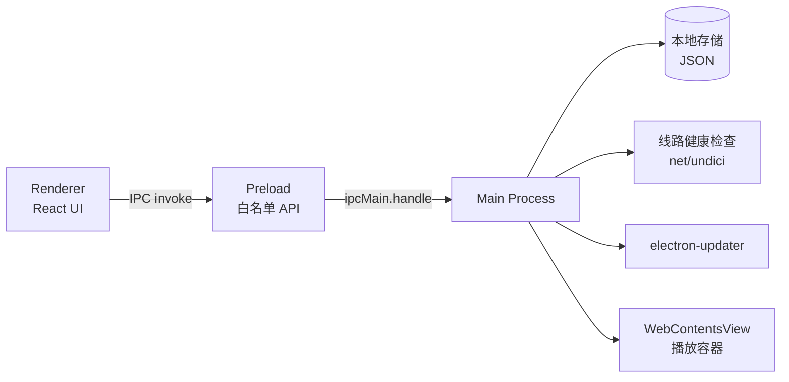

# Free Video · 跨平台 VIP 视频解析播放客户端 需求文档（PRD）

| 项目 | 内容 |
| --- | --- |
| 产品名称 | Free Video |
| 文档版本 | v1.0 |
| 编写日期 | 2026-10-29 |
| 参考项目 | <https://github.com/huangguangda/free_vip_video> |
| 技术底座 | Electron 44 + React 19 + TypeScript + Tailwind CSS 4 + shadcn/ui（electron-vite 构建）+ electron-builder |
| 交付形态 | 开源桌面客户端（Windows / macOS / Linux），GitHub Actions 自动构建与发布 |

---

## 1. 背景与目标

### 1.1 背景

参考项目 `free_vip_video` 是一个单文件 HTML 页面，原理很朴素：

1. 维护一份"解析接口"列表（约 48 条线路）；
2. 用户粘贴视频平台（腾讯视频、爱奇艺、优酷、芒果 TV 等）的播放页地址；
3. 页面把 `解析接口前缀 + 视频地址` 拼接后塞进 `<iframe>`，由第三方接口返回可播放的页面/直链。

网页版存在的问题：线路多但无法管理、失效无提示、每次要手动找、无历史记录、无法安装、非桌面体验。

### 1.2 产品目标

把网页版的能力产品化为一个可安装、可自维护的跨平台桌面客户端：

- **开箱即用**：安装后粘贴链接即可播放，内置线路库遵循"先可用、再齐全"的原则；
- **线路可管理**：内置线路可启用/禁用/排序，支持自定义添加，配置持久化；
- **失败可自愈**：解析失败自动切换下一条可用线路，线路可用性可视化；
- **可持续**：开源 + GitHub Actions 三平台自动打包，标签发布即出安装包，内置自动更新。

### 1.3 非目标（本期不做）

- 不做视频资源的存储、转录、下载分发；
- 不内置、不代理任何视频内容，仅作为第三方解析页面的容器；
- 不做移动端（Android / iOS）；
- 不做账号体系、云同步、社区评论；
- 不做 DRM 破解、不做平台登录态注入。

---

## 2. 名词与概念

| 名词 | 说明 |
| --- | --- |
| 线路 / 解析接口 | 一条形如 `http://api.example.com/parse?url={url}` 的第三方解析地址，把视频页地址作为参数传入 |
| 目标视频地址 | 用户在视频平台复制来的页面 URL，如 `https://v.qq.com/x/cover/xxx.html` |
| 拼接模式 | 线路 URL 与目标地址的组合方式：**前缀式**（`前缀 + 目标地址`）与 **模板式**（`{url}` 占位符替换） |
| 播放容器 | 承载解析结果的 Web 内容视图（`<webview>` / `WebContentsView`） |
| 健康检查 | 客户端对线路发起探测请求，判定其当前是否可用的过程 |

---

## 3. 用户画像与使用场景

**目标用户**：希望在 PC 上以桌面应用形式观看 VIP 内容的普通用户，愿意接受"线路失效需自行维护"的现实。

**核心场景**

- S1 快速观看：复制视频页链接 → 打开客户端 → 自动识别并提示解析 → 点击播放。
- S2 线路救火：当前线路播放失败 → 一键切换到下一条线路，或设置中启用自动切换。
- S3 线路维护：用户发现某线路长期失效 → 在设置中禁用它，或添加社区分享的新线路。
- S4 回看：从历史记录中重新打开上周看过的剧集。
- S5 新设备安装：从 GitHub Releases 下载对应平台安装包，之后由应用内自动更新。

---

## 4. 功能需求

优先级：**P0** 首版必须，**P1** 首版应有，**P2** 后续迭代。

### 4.1 解析与播放（P0）

| 编号 | 需求 | 说明 |
| --- | --- | --- |
| F-101 | 视频地址输入 | 顶部地址栏输入/粘贴目标视频页 URL，回车或点击"播放"触发解析 |
| F-102 | 地址合法性校验 | 仅接受 `http/https` 且符合 URL 语法；非法时行内提示，不发起请求 |
| F-103 | 平台识别 | 根据域名识别平台（腾讯视频、爱奇艺、优酷、芒果 TV、哔哩哔哩等），显示平台图标/名称 |
| F-104 | 线路选择 | 下拉选择当前使用的线路，默认取"排序最前且健康"的线路，记住上次选择 |
| F-105 | 播放 | 将线路地址与目标地址拼接后在播放容器中加载 |
| F-106 | 自动备用线路 | 当前线路加载失败/超时（默认 15s）时，按排序自动尝试下一条可用线路，最多尝试 N 条（默认 5），全部失败给出明确提示 |
| F-107 | 播放控制条 | 重新加载、切换线路、复制当前解析地址、全屏、返回首页 |
| F-108 | 桌面行为 | 支持 `F11` 全屏、`Esc` 退出全屏；播放容器内的窗口弹出由主进程拦截并转为应用内打开 |

> **技术要点**：第三方解析页普遍返回带 `X-Frame-Options` / `Content-Security-Policy: frame-ancestors` 的页面，普通 `<iframe>` 会被浏览器拒绝。因此桌面端必须使用 Electron 的 `<webview>` 标签（需在 `webPreferences` 中开启 `webviewTag`）或主进程的 `WebContentsView`，二者以独立 frame 加载，不受该限制。

### 4.2 线路管理（P0）

| 编号 | 需求 | 说明 |
| --- | --- | --- |
| F-201 | 内置线路库 | 随应用内置初始线路（见附录 A），标记 `builtin: true`，可禁用但不可删除 |
| F-202 | 启用/禁用 | 开关控制线路是否参与选择与自动切换 |
| F-203 | 排序 | 支持置顶/上移/下移，顺序持久化，影响默认选择与自动切换顺序 |
| F-204 | 新增自定义线路 | 表单字段：名称（必填）、接口地址（必填）、拼接模式（前缀式/模板式）、备注（选填） |
| F-205 | 编辑/删除 | 内置线路仅可改名称与启用状态；自定义线路可完整编辑与删除 |
| F-206 | 校验与预览 | 保存时校验 URL 语法；提供"预览拼接结果"展示最终请求地址 |
| F-207 | 导入/导出 | 线路配置导出为 JSON 文件；支持从 JSON 导入（去重，冲突以用户选择为准） |
| F-208 | 恢复默认 | 一键将内置线路恢复到初始状态（不影响自定义线路） |

### 4.3 线路健康检查（P1）

| 编号 | 需求 | 说明 |
| --- | --- | --- |
| F-301 | 手动检测 | "全部检测"按钮，并发（默认并发 6）探测所有启用线路 |
| F-302 | 状态展示 | 每条线路显示状态徽标：未知 / 可用 / 失败 / 超时 / 不支持，并展示响应耗时 |
| F-303 | 后台定时检测 | 应用启动后延迟检测一次；之后按设置间隔（默认关闭，可设 30 分钟 / 1 小时）检测 |
| F-304 | 检测策略 | 主进程发起请求（绕过渲染进程跨域限制），超时 8s；仅判定"服务可达 + 返回非 4xx/5xx"，不保证解析结果可播放 |
| F-305 | 结果缓存 | 检测结果落盘，重启后仍保留最近一次状态与时间 |

### 4.4 历史记录与收藏（P1）

| 编号 | 需求 | 说明 |
| --- | --- | --- |
| F-401 | 播放历史 | 自动记录最近 100 条：视频地址、平台、标题（如解析页可取则取，否则取 URL）、最后使用线路、时间 |
| F-402 | 历史操作 | 点击重新播放、单条删除、清空全部 |
| F-403 | 收藏 | 可收藏视频，收藏项单独列表，可备注名称 |
| F-404 | 剪贴板识别（P1） | 应用在前台时检测剪贴板中的视频页地址，浮层提示"解析此链接"，用户点击才生效（不自动播放） |

### 4.5 设置（P0）

| 编号 | 需求 | 说明 |
| --- | --- | --- |
| F-501 | 外观 | 主题：深色 / 浅色 / 跟随系统 |
| F-502 | 自动切换 | 开关 + 最多尝试线路数 |
| F-503 | 超时 | 播放加载超时（5–60s）、健康检查超时（3–20s） |
| F-504 | 网络 | 可选自定义 User-Agent、可选代理（系统 / 手动 / 不使用） |
| F-505 | 数据 | 数据目录展示、导出配置、清空全部数据（二次确认） |
| F-506 | 更新 | 检查更新、当前版本、更新通道（稳定版） |
| F-507 | 关于 | 版本号、GitHub 地址、开源许可、免责声明全文 |

### 4.6 自动更新（P2）

| 编号 | 需求 | 说明 |
| --- | --- | --- |
| F-601 | 检查更新 | 基于 `electron-updater` + GitHub Releases，启动后静默检查 + 手动检查 |
| F-602 | 下载与安装 | 后台下载，完成后提示"重启并安装"；Windows / macOS / Linux（AppImage）支持 |
| F-603 | 失败降级 | 更新失败不阻塞使用，仅记录日志并提示手动前往 Releases 下载 |

### 4.7 合规与提示（P0）

| 编号 | 需求 | 说明 |
| --- | --- | --- |
| F-701 | 首次启动声明 | 首启展示免责声明弹窗，确认后方可使用；可在"关于"中重新查看 |
| F-702 | 内容边界 | 应用不存储、不分发、不缓存视频内容；所有解析页面由第三方提供 |
| F-703 | 线路来源说明 | 内置线路来自公开分享，可用性不做保证，用户可自行增删 |

---

## 5. 非功能需求

| 类别 | 指标 |
| --- | --- |
| 性能 | 冷启动 ≤ 3s（M 系 Mac / 主流 Win）；首屏可交互 ≤ 1.5s；空闲内存 ≤ 300MB |
| 兼容 | Windows 10+（x64，NSIS 安装包 + 便携版）；macOS 12+（x64 / arm64，DMG）；Linux（AppImage / deb，x64） |
| 安全 | `contextIsolation: true`、`nodeIntegration: false`、`sandbox: true`（渲染进程）；preload 仅暴露白名单 IPC；播放容器禁用 Node API；外部链接一律 `shell.openExternal`；主 UI 的 CSP 收紧到 `self`（解析页运行在独立 `WebContentsView`，不共享主 UI 的 CSP） |
| 稳定性 | 单次解析失败不得导致应用崩溃；主进程异常时保留渲染进程；关键操作用户可撤销（删除前二次确认） |
| 可维护性 | 线路数据与代码分离；类型全覆盖，`typecheck` 纳入 CI 必过项 |
| 可访问性 | 全部交互可用键盘完成；焦点可见；对比度符合 WCAG AA |
| 国际化 | 首版中文；文案集中在单一资源文件，为后续 i18n 预留 |

---

## 6. 技术方案要点

### 6.1 进程架构



- **Main**：窗口生命周期、线路探测、存储读写、自动更新、外链打开、播放容器管理。
- **Preload**：只暴露 `player`、`lines`、`history`、`settings`、`updater` 五组命名空间的方法，全部走 `invoke/handle`。
- **Renderer**：纯 UI，不直接发网络请求（健康检查与解析加载均由主进程执行，避免跨域与 CORS 问题）。

### 6.2 线路数据模型

```ts
type JoinMode = 'prefix' | 'template' // 前缀式 / {url} 模板式
type LineStatus = 'unknown' | 'ok' | 'fail' | 'timeout' | 'unsupported'

interface ParseLine {
  id: string            // uuid
  name: string
  endpoint: string      // 前缀式: 'http://api.x.com/p?url='  模板式: 'http://api.x.com/p?u={url}'
  joinMode: JoinMode
  builtin: boolean
  enabled: boolean
  order: number
  note?: string
  // 运行态（由健康检查写入）
  status: LineStatus
  latencyMs?: number
  checkedAt?: number
}
```

拼接规则：

- `prefix`：`endpoint + encodeURIComponent(videoUrl)`（参考项目即此模式）
- `template`：`endpoint.replace('{url}', encodeURIComponent(videoUrl))`

### 6.3 本地存储

使用 `electron-store` 12（主进程为唯一实例来源），按域拆分为独立文件；原子写由库负责，数据校验统一由 zod 承担，版本迁移用项目内的纯函数实现：

```
settings.json   // 主题、超时、并发数、代理、UA、更新通道
lines.json      // 线路列表（含内置线路的用户覆盖层：enabled/order/name）
history.json    // 最近 100 条
favorites.json  // 收藏
```

内置线路随包以 `resources/lines.default.json` 提供（`asarUnpack` 已配置），启动时与用户覆盖层合并，**升级应用不会覆盖用户改动**。

### 6.4 播放容器选型

| 方案 | 优点 | 缺点 | 结论 |
| --- | --- | --- | --- |
| `<iframe>` | 简单 | 受 `X-Frame-Options` / CSP 限制，绝大多数解析页无法加载 | 否 |
| `<webview>` | 易与 React 布局融合，可前进后退/重载 | 官方标注不推荐，Electron 新版本逐步弱化 | 备选 |
| `WebContentsView` | 官方推荐，隔离性好，可控 `partition` | 需主进程管理布局，随窗口 resize 同步 bounds | **首选** |

采用 **`WebContentsView`**：主进程负责创建与销毁；渲染进程通过 `player:open({ lineId, videoUrl })` 发起播放，并用 `player:set-bounds(rect)` 上报预留区域、`player:set-visible(boolean)` 控制显隐（离开播放页时隐藏，避免覆盖弹窗），窗口 resize 时由主进程同步 `setBounds`。

### 6.5 解析失败判定

加载失败无法从页面内部可靠获知（第三方页面各不相同），采用多信号判定：

1. `did-fail-load`（网络错误 / 4xx / 5xx）；
2. 主进程超时计时器（可配，默认 15s）内未触发 `did-finish-load`；
3. 页面白屏启发式：加载完成后 `executeJavaScript` 检测 `document.body.innerText` 是否包含"解析失败/无效/error"等关键词（弱信号，仅用于提示，不自动切换）。

满足 1 或 2 即视为失败并触发自动切换；3 只显示"可能解析失败，试试其他线路？"的提示条。

---

## 7. GitHub CI 与发布

### 7.1 工作流

两个工作流已落在 `.github/workflows/`，随仓库一起维护。

**`build.yml` —— 每次 push / PR 跑三平台构建**

- 触发：`push`（main）、`pull_request`、`workflow_dispatch`；并发组按 ref 自动取消旧运行。
- 矩阵：`ubuntu-latest → --linux`、`windows-latest → --win`、`macos-latest → --mac`，`fail-fast: false`，任一平台失败不影响其余两平台。
- 步骤：`checkout → pnpm/action-setup（版本取自 package.json 的 packageManager）→ setup-node 22 + pnpm 缓存 → 缓存 Electron / electron-builder → pnpm install --frozen-lockfile → pnpm lint → pnpm build → electron-builder <flag> --publish never → upload-artifact`。
- 产物以 `dist-{OS}` 命名保留 14 天，只收集安装包与 `.yml` / `.blockmap` 更新元数据。
- 设置 `CSC_IDENTITY_AUTO_DISCOVERY=false`：未配置证书时跳过 macOS 签名查找，避免构建卡在钥匙串。

**`release.yml` —— 打 `v*` tag 发布**

- 触发：`push: tags: ['v*']`，`permissions: contents: write` 供 electron-builder 创建 Release。
- 前置校验：tag 去掉 `v` 后必须等于 `package.json` 的 `version`，不一致直接失败。
- 三平台矩阵同上，最后一步 `electron-builder <flag> --publish always`，`GH_TOKEN` 使用内置 `secrets.GITHUB_TOKEN`。

> 本地复现：`pnpm build && pnpm exec electron-builder --mac --publish never`（其余平台同理）。
> 国内网络若在打包阶段卡在下载 `dmgbuild` / `nsis` 等二进制（`Timeout awaiting 'request'`），设置 `ELECTRON_BUILDER_BINARIES_MIRROR=https://npmmirror.com/mirrors/electron-builder-binaries/` 即可绕过，CI 位于境外无需此步。

### 7.2 发布约定

- **版本**：SemVer，`package.json` 为唯一来源；`git tag v1.2.3` 触发发布。
- **产物命名**：`FreeVideo-{version}-win-{arch}.exe`、`FreeVideo-{version}-mac-{arch}.dmg`、`FreeVideo-{version}-mac-{arch}.zip`（自动更新用）、`FreeVideo-{version}-linux-x86_64.AppImage`、`FreeVideo-{version}-linux-amd64.deb`。
- **macOS 双架构**：`mac.target` 对 `dmg` / `zip` 均声明 `arch: [x64, arm64]`，一次 `--mac` 构建产出 Intel 与 Apple Silicon 两套包（4 个产物），`latest-mac.yml` 同时登记两者，自动更新按用户机器架构各自匹配。
- **更新源**：`electron-builder.yml` 的 `publish` 由 `generic` 改为 `provider: github`，`releaseType: release`；`electron-updater` 与之联动。
- **签名**：首版 macOS 走 ad-hoc 签名（`mac.identity: '-'`），Windows 不签名（SmartScreen 提示）。ad-hoc 不是为了过 Gatekeeper，而是绕开 Apple Silicon 的结构性故障：arm64 可执行文件由 linker 预签名却没有 `CodeResources` 资源封条，整包不签会被判定"已损坏"，连"右键打开"都无法绕过。签名后用户仍会看到"无法验证开发者"，需右键 → 打开。启用 hardenedRuntime 时须在 `build/entitlements.mac.plist` 放开 `com.apple.security.cs.disable-library-validation`，否则 Electron 加载框架会被库校验拦下。
- **接入正式证书**：通过 `CSC_LINK` / `CSC_KEY_PASSWORD` / `APPLE_ID` 等 secrets 接入 Developer ID 后，把 `mac.identity` 改为证书名（或删除该行）、`notarize` 改为 `true`，即可获得公证与双击直开体验。
- **缓存**：`~/.cache/electron`、`~/.cache/electron-builder` 用 `actions/cache` 复用，缩短构建时间。

### 7.3 分支与提交

- `main` 保护分支，PR 必须过 `lint` + `typecheck` + 三平台构建；
- 提交遵循 Conventional Commits（`feat:` / `fix:` / `chore:`），供后续自动生成 CHANGELOG。

---

## 8. 里程碑

| 阶段 | 内容 | 交付物 | 预估 |
| --- | --- | --- | --- |
| M0 | 工程基建 | 目录分层、IPC 骨架、存储封装、CI 三平台跑通 | 2 天 |
| M1 | 解析播放闭环 | 地址输入 → 线路选择 → WebContentsView 播放 → 加载/错误态 | 3 天 |
| M2 | 线路管理 | 增删改查、排序、启用、导入导出、健康检查 | 3 天 |
| M3 | 历史/收藏/设置 | 本地持久化、主题、剪贴板识别 | 2 天 |
| M4 | 发布与更新 | release workflow、自动更新、首批三平台安装包 | 2 天 |
| M5 | 打磨 | 空态/错误态、快捷键、可访问性、免责声明 | 1 天 |

---

## 9. 验收标准

1. Windows / macOS / Linux 三平台安装包均可从 GitHub Releases 下载并正常启动；
2. 粘贴一条腾讯视频或爱奇艺页面地址，选择任一"可用"线路后可正常播放，且全屏可用；
3. 当前线路加载失败时，若开启自动切换，应用能自动落到下一条可用线路并给出提示；
4. 新增一条自定义线路（模板式，含 `{url}`）后，预览地址正确，且能被选中并播放；
5. 关闭应用重开后，主题、线路启停与排序、历史记录、上次使用线路全部保留；
6. 应用升级后，用户对内置线路的启用/排序改动与自定义线路不丢失；
7. 首启出现免责声明弹窗，未确认前不可使用核心功能；
8. 渲染进程无 Node 能力（`window.require` 为 undefined），外部链接在系统浏览器打开；
9. CI：PR 触发三平台构建全绿，`v*` tag 自动产出 Release 与全部安装包。

---

## 10. 风险与对策

| 风险 | 影响 | 对策 |
| --- | --- | --- |
| 内置线路大面积失效（参考项目多数接口已停服） | 首次体验极差 | 首版上线前人工筛选可用线路；健康检查默认在首启自动跑一次；把"自定义线路"做成一等公民并在空态引导 |
| 第三方页面弹窗/跳广告/劫持导航 | 体验与安全 | 主进程拦截 `will-navigate` 与 `setWindowOpenHandler`，非白名单域名一律外部打开或拒绝 |
| `X-Frame-Options` 导致无法加载 | 功能不可用 | 采用 `WebContentsView`（见 6.4），不用 `iframe` |
| 自动切换误判（页面正常但加载慢） | 反复跳转 | 超时可配；同一线路连续失败 2 次才计入"暂停使用" |
| 平台反爬、接口下线 | 长期不可控 | 应用不承诺内容可用性；线路库支持导入导出与社区分享 |
| **合规与版权** | 法律与下架风险 | 应用仅作播放器外壳，不分发内容；首启免责声明；README 明确"仅供学习研究，请支持正版"；不内置任何视频源直链 |
| macOS 未签名被 Gatekeeper 拦截 | 安装受阻 | Release 说明中给出"右键 → 打开"指引；后续接入公证 |

---

## 附录 A：内置线路库（来自参考项目，需上线前复检）

> 说明：以下接口原样摘录自参考项目，绝大多数为个人分享的第三方服务，**可用性不做保证**。内置数据以 `resources/lines.default.json` 形式随包发布，此处仅作源清单留存。

| # | 名称 | 接口地址 | 拼接模式 |
| --- | --- | --- | --- |
| 1 | 超清 | `http://api.baiyug.cn/vip/index.php?url=` | prefix |
| 2 | 线路1 | `http://www.vipjiexi.com/yun.php?url=` | prefix |
| 3 | 线路2 | `http://api.1008net.com/v.php?url=` | prefix |
| 4 | 线路3 | `http://api.nepian.com/ckparse/?url=` | prefix |
| 5 | 线路4 | `http://player.jidiaose.com/supapi/iframe.php?v=` | prefix |
| 6 | 线路5 | `http://api.pucms.com/index.php?url=` | prefix |
| 7 | 线路6 | `http://api.wlzhan.com/sudu/?url=` | prefix |
| 8 | 线路7 | `http://www.0335haibo.com/yun.php?url=` | prefix |
| 9 | 线路8 | `http://yun.mt2t.com/yun?url=` | prefix |
| 10 | 线路9 | `http://y.mt2t.com/lines?url=` | prefix |
| 11 | 线路11 | `http://www.sfsft.com/video.php?url=` | prefix |
| 12 | 线路12 | `http://www.82190555.com/video.php?url=` | prefix |
| 13 | 线路13 | `http://2.jx.72du.com/video.php?url=` | prefix |
| 14 | 线路14 | `http://www.97panda.com/kkflv/index.php?url=` | prefix |
| 15 | 线路15 | `http://jx.vgoodapi.com/jx.php?url=` | prefix |
| 16 | 线路16 | `http://www.dgua.xyz/webcloud/?url=` | prefix |
| 17 | 线路17 | `http://api.91exp.com/svip/?url=` | prefix |
| 18 | 线路18 | `http://vip.jlsprh.com/index.php?url=` | prefix |
| 19 | 线路19 | `http://api.xfsub.com/index.php?url=` | prefix |
| 20 | 线路20 | `http://jiexi.071811.cc/jx.php?url=` | prefix |
| 21 | 线路21 | `http://jiexi.92fz.cn/player/vip.php?url=` | prefix |
| 22 | 线路23 | `http://api.662820.com/xnflv/index.php?url=` | prefix |
| 23 | 线路24 | `http://www.82190555.com/index/qqvod.php?url=` | prefix |
| 24 | 线路25 | `http://yyygwz.com/index.php?url=` | prefix |
| 25 | 线路27 | `http://jx.api.163ren.com/vod.php?url=` | prefix |
| 26 | 线路28 | `http://lookxw.com/yingzi/?url=` | prefix |
| 27 | 线路29 | `http://www.0335haibo.com/tong.php?url=` | prefix |
| 28 | 线路30 | `http://www.wmxz.wang/video.php?url=` | prefix |
| 29 | 线路31 | `http://api.97kn.com/?url=` | prefix |
| 30 | 线路32 | `https://aikanapi.duapp.com/odflv105/index.php?url=` | prefix |
| 31 | 线路33 | `http://v.buy360.vip/wwcx/index.php?url=` | prefix |
| 32 | 线路34 | `http://api.lequgirl.com/?url=` | prefix |
| 33 | 线路35 | `https://jxapi.nepian.com/ckparse/?url=` | prefix |
| 34 | 线路36 | `http://91k.co/play.php?url=` | prefix |
| 35 | 线路37 | `http://www.52jiexi.com/yun.php?url=` | prefix |
| 36 | 线路38 | `http://mt2t.com/yun?url=` | prefix |
| 37 | 线路39 | `http://000o.cc/jx/ty.php?url=` | prefix |
| 38 | 线路41 | `http://vipjiexi.com/vip.php?url=` | prefix |
| 39 | 线路43 | `http://jx.ck921.com/?url=` | prefix |
| 40 | 线路44 | `http://s1y2.com/?url=` | prefix |
| 41 | 线路45 | `http://www.ou522.cn/t2/1.php?url=` | prefix |
| 42 | 线路46 | `http://jx.xuanpianwang.com/parse?url=` | prefix |
| 43 | 线路47 | `https://apiv.ga/magnet/` | template（磁力检索，非视频解析，默认禁用） |

> 参考项目中的"线路22/26/40/42/48"为重复条目，已去重。
